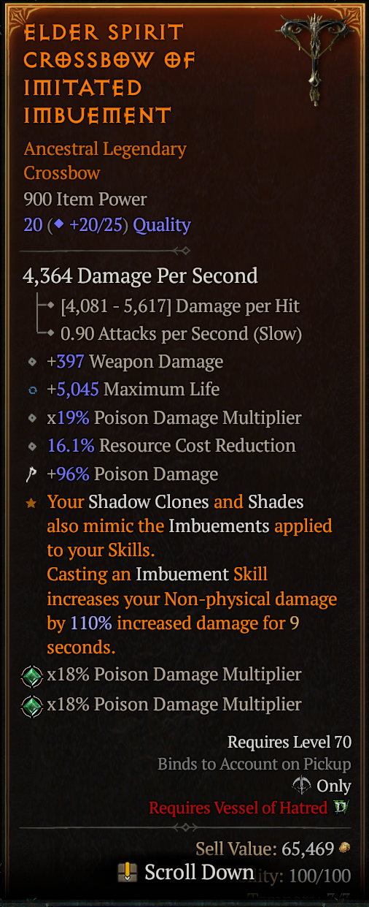

# Diablo IV: Item Tooltip OCR

Utilizing PaddleOCR and a custom Diablo 4 trained recognition model. Outputs item tooltip data in JSON-format.


## Example



```json
{
   "affixes": [
      "+397 Weapon Damage",
      "+5,045 Maximum Life",
      "x19% Poison Damage Multiplier",
      "16.1% Resource Cost Reduction",
      "+96% Poison Damage"
   ],
   "aspect": "Your Shadow Clones and Shades also mimic the Imbuements applied to your Skills. Casting an Imbuement Skill increases your Non-physical damage by 110% increased damage for 9 seconds.",
   "enchanted_affixes": [
      "+5,045 Maximum Life"
   ],
   "greater_affixes": [],
   "item_power": "900",
   "name": "ELDER SPIRIT CROSSBOW OF IMITATED IMBUEMENT",
   "quality": "20",
   "quality_max": "25",
   "quality_upgraded": "20",
   "sockets": [
      "x18% Poison Damage Multiplier",
      "x18% Poison Damage Multiplier"
   ],
   "stats": [
      "4,364 Damage Per Second",
      "[4,081 - 5,617] Damage per Hit",
      "0.90 Attacks per Second (Slow)"
   ],
   "tempered_affixes": [
      "+96% Poison Damage"
   ],
   "type": "Ancestral Legendary Crossbow"
}
```

`affixes` lists all affixes. `greater_affixes`, `tempered_affixes` and `enchanted_affixes` repeat those affixes that have the respective icon.


## Installation

- Clone repository

- Create a Python3 enviroment (I recommend using https://www.anaconda.com/download on Windows)

- pip install -r requirements.txt

You will need to install the correct version of PaddlePaddle depending on your environment (CPU/GPU/CUDA version). Please refer to this link:
https://www.paddlepaddle.org.cn/install/quick?docurl=/documentation/docs/en/install/pip/windows-pip_en.html#old-version-anchor-3-INSTALLATION

## Using

### Output json to console
```
python d4-item-tooltip-ocr.py --source-img=tests\screenshots\3440x1440_beside_overview_panel.png
python d4-item-tooltip-ocr.py --source-img=tests\quality_partial_two_sockets.png --find-tooltip=False
```

### Output json to file
```
python d4-item-tooltip-ocr.py --source-img=tests\screenshots\3440x1440_beside_overview_panel.png --json-output=item-tooltip-data.json
python d4-item-tooltip-ocr.py --source-img=tests\quality_partial_two_sockets.png --json-output=item-tooltip-data.json --find-tooltip=False
```

### Debug mode
```
python d4-item-tooltip-ocr.py --debug=True --source-img=tests\screenshots\3440x1440_beside_overview_panel.png
python d4-item-tooltip-ocr.py --debug=True --source-img=tests\quality_partial_two_sockets.png --find-tooltip=False
```

### Run tests
```
python d4-item-tooltip-ocr.py --run-tests-dir=tests
python d4-item-tooltip-ocr.py --run-tests-dir=tests\screenshots --find-tooltip=True
```
Every image in the directory that has a definition with the same name (`.json`) is processed and compared with it field by field. The images in `tests` are cropped to the item tooltip, so tooltip detection is off by default in this mode (`--find-tooltip=True` turns it on). The full screenshots in `tests\screenshots` test the tooltip detection. The debug window's "Save JSON" button writes such a definition for the current image; check and correct it before adding it to the tests.

### Recognition errors
`d4-vocabulary.txt` lists words that appear in item tooltips. A recognized word that is not in the list is corrected if exactly one listed word can be reached by inserting a letter the recognizer tends to drop (such as "Immobiizes") or by replacing a commonly confused one (such as "Iewelry"). Add words to the list if a correct word gets changed into another one.
